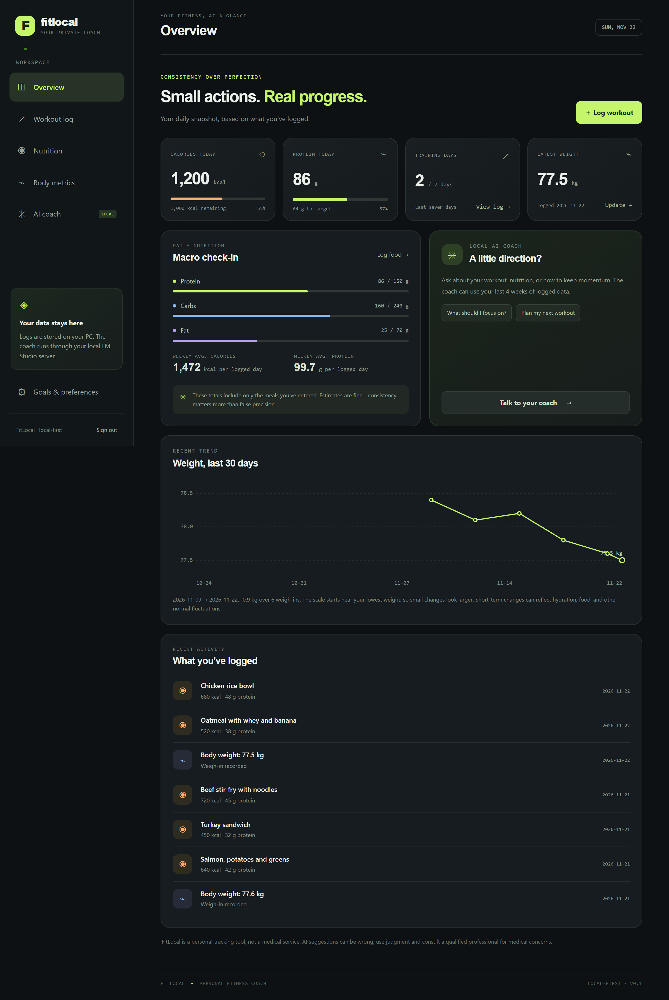
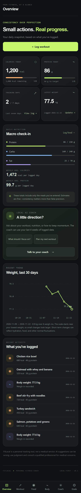

# Tally

**Your private AI coach.** Formerly *FitLocal*. Today Tally covers fitness; finances and an AI-organized brain dump are planned.

A self-hosted personal fitness tracker with a private AI coach. Log workouts set by set, meals, and body weight from your phone; ask a coach that runs entirely on your own PC (through [LM Studio](https://lmstudio.ai)) for a weekly review, a workout plan, or a meal idea based on your last 4 weeks of data.

It is built for one person, runs on a Windows PC, and is reachable only over [Tailscale](https://tailscale.com). Nothing leaves your machines: no cloud, no third-party requests from the browser, no telemetry. The one exception is opt-in: [logging from Discord](#logging-from-discord) connects to Discord when you turn it on.

<p>
  
  
</p>

<sub>Screenshots use synthetic data.</sub>

## How this was built

Tally is my attempt at building an application with an **AI-native software development life cycle (SDLC)**. The intent, the spec and the build plan were written before any code, and they guided the design, implementation and tests from there. If you want to develop apps with AI, start with [`docs/spec/.initial/`](docs/spec/.initial/). Its [README](docs/spec/.initial/README.md) explains the approach and how to read the documents:

- [intent.md](docs/spec/.initial/intent.md): goals, stack and the main design choices, in about two pages.
- [spec.md](docs/spec/.initial/spec.md): the normative design. Every decision has an ID and a reason.
- [plan.md](docs/spec/.initial/plan.md): milestones, each with a "Done when" gate that can be checked.

Later features follow the same pattern in their own folder, for example [`docs/spec/20261122-discord-ingest/`](docs/spec/20261122-discord-ingest/) (logging from a Discord channel).

## Architecture

```
 Phone / laptop (tailnet)                     Windows PC
 ┌──────────────┐  HTTPS   ┌───────────────┐  HTTP   ┌──────────────────────────────┐
 │ Browser      │─────────▶│ Tailscale     │────────▶│ tally.jar  127.0.0.1:8765 │
 │ React SPA    │◀─────────│ Serve         │         │  ├─ static/ (Vite build)     │
 │ localStorage:│          └───────────────┘         │  ├─ /api/** (Spring MVC)     │
 │  draft, chat │                                    │  ├─ Spring Security filter   │
 └──────────────┘                                    │  └─ JPA ─▶ data/tally.db  │
                                                     │        RestClient            │
                                                     │          │                   │
                                                     │          ▼                   │
                                                     │  LM Studio 127.0.0.1:1234/v1 │
                                                     └──────────────────────────────┘
```

| Layer | Choice |
|---|---|
| Backend | Spring Boot 4 on JDK 21: Spring MVC, Spring Security, Spring Data JPA |
| Database | SQLite (`sqlite-jdbc` + Hibernate community SQLite dialect) |
| Frontend | React + Vite. No router, state library, or chart library |
| LLM | LM Studio's OpenAI-compatible API, called with Spring `RestClient` |
| Packaging | One jar: the Vite build is served as Spring static resources |

Main design choices:

- **Single jar, single process.** `start.bat` builds the UI, packages it into the jar, and runs it.
- **SQLite with a committed `schema.sql`.** The schema is applied on every startup with `CREATE TABLE IF NOT EXISTS`. There is no migration tool; Hibernate never creates or alters tables. Dates are stored as ISO text so they sort and compare correctly.
- **Workout drafts live in the browser.** An in-progress session is saved to `localStorage` on every change, so it survives a refresh, closing the browser, or losing the connection. It is sent once with **Finish workout**, and only cleared after the server confirms. Each draft carries a `submissionId`, so a retried submit whose first response was lost does not create a duplicate.
- **The app does the arithmetic, not the model.** Each coach request includes the last 4 weeks as compact labeled plain text, with daily totals, differences from your targets and weekly counts already computed. See [LLM notes](#llm-notes).

The full requirements and design decisions are in [spec.md](docs/spec/.initial/spec.md).

## Security model

| Layer | Protects against |
|---|---|
| Bind to `127.0.0.1` | Anything on the LAN or Wi-Fi. The app is not reachable off the PC except through Tailscale. |
| Tailscale Serve (HTTPS, tailnet ACLs) | The internet. Encrypts traffic in transit. Only your tailnet devices can connect. |
| Cookie auth (BCrypt password + HMAC-signed token) | Other tailnet devices or users, and other local OS users. |
| `HttpOnly` cookie | Token theft through XSS: JavaScript cannot read the token. |
| `SameSite=Strict` + JSON-only mutations | CSRF (see below). |
| DOMPurify-sanitized Markdown + Content-Security-Policy | XSS through model output. |
| Discord ingestion (opt-in) | Only one channel, only allow-listed Discord users. Outbound connection only; no inbound port. Replies never ping anyone. Off unless a bot token is set. |
| Not in scope | Login rate limiting (tailnet-only), multi-user isolation, LM Studio's own API (unauthenticated on localhost). |

**Auth tokens.** Signing in sets a 30-day token in an `HttpOnly; Secure; SameSite=Strict` cookie. The token is `payload.signature`, where the signature is an HMAC-SHA256 over the payload and the user's current password hash, keyed with a random secret in `data/signing.key`. Changing a password therefore signs out that user's devices, and deleting the key signs out every device. No JWT library is involved.

**Why there is no CSRF token.** Browsers never send a `SameSite=Strict` cookie on a request that starts from another site. As a second layer, every endpoint that changes data only accepts `Content-Type: application/json`, which a cross-site HTML form cannot send without a CORS preflight that the app never approves.

**Secrets.** Backend secrets (such as the Discord bot token) live only in `secrets.properties` at the repo root, which git ignores. They are never in the committed `application.properties` or inside the built jar, and the app never logs them or the text of your Discord messages.

## Setup

You need **JDK 21** and, for building, **Node.js LTS**. For the coach you also need **LM Studio** with a downloaded model (gpt-oss-20B or Qwen3 14B are the targets).

1. Install the JDK, for example `winget install EclipseAdoptium.Temurin.21.JDK`, and Node.js. Open a new terminal afterwards so both are on `PATH`.
2. Clone this repository.
3. *(Optional)* Configure secrets. Copy `secrets.properties.example` to `secrets.properties` and fill in only what you use; every key is optional and a missing file is fine. This file is the one place for **any** backend secret or personal value, for any feature. It is gitignored, overrides the defaults in `backend/src/main/resources/application.properties`, and is read when the app starts, so changes only need a restart. Today it only holds the [Discord](#logging-from-discord) settings.
4. Create your user. The first run builds the app, which takes a few minutes:
   ```
   start.bat --create-user <username>
   ```
   You are asked for a password (at least 8 characters) twice. It is never shown or accepted as an argument.
5. Start Tally:
   ```
   start.bat
   ```
   This runs Tally on `http://127.0.0.1:8765` and leaves LM Studio alone, so startup stays light. The tracker doesn't need LM Studio; only the coach does. When you want the coach, either start LM Studio yourself, load a model and start its server (port 1234, the default), or start Tally with:
   ```
   start.bat --coach
   ```
   `--coach` starts LM Studio if it isn't running. If a model is already loaded, it uses that one and loads nothing. Otherwise, on the first `--coach` run it lists your LM Studio models and asks which one to use, saves the answer in `tally.local.cmd` (not committed), and loads it with a 20K context. Either way it starts the LM Studio API on `127.0.0.1:1234` if needed. The coach picks up a model loaded later too: no Tally restart needed.
6. Point Tailscale Serve at the app (once): `tailscale serve --bg 8765`, then open the HTTPS URL it prints from your phone.
7. On iPhone, use **Share → Add to Home Screen**. Safari can clear site storage for sites that are not used for a week unless they are on the Home Screen, and the workout draft and chat history are kept in that storage.

### Start with Windows (optional)

1. Press `Win + R`, enter `shell:startup`, and press Enter.
2. In that folder, create a shortcut to `start.bat`. Optionally set the shortcut's **Run** to **Minimized**.

This is a login startup, not a Windows service: it runs after you sign in. The PC must stay on and the Tally window must stay running. Tailscale should start with Windows; its Serve configuration persists. The launcher never runs `tailscale funnel`.

To have the coach ready at login too, add `--coach` to the shortcut's target after running `start.bat --coach` once by hand, so the first-run model question is answered. LM Studio must then stay running as well. `--coach` starts LM Studio's API bound to `127.0.0.1` only.

## Logging from Discord

Post your logs as messages in a Discord channel from anywhere. Your PC doesn't need to be on: when Tally next starts it catches up on what you posted, then handles new messages live while it runs. It's off unless you configure it.

### Setup

1. In the [Discord developer portal](https://discord.com/developers/applications), create an application, open **Bot**, and copy the token (**Reset Token**).
2. On the same page, turn on **Message Content Intent**. Without it the bot sees empty messages and Tally logs a warning.
3. Invite the bot to a server you control (**OAuth2 → URL Generator**, scope `bot`) with **View Channel**, **Read Message History**, **Send Messages** and **Add Reactions** on your log channel. Use a channel just for logs.
4. In Discord, go to **User Settings → Advanced** and turn on **Developer Mode**. Then right-click the channel → **Copy Channel ID**, and click your avatar at the bottom left → **Copy User ID**.
5. Put the three values in `secrets.properties` (see [Setup](#setup) step 3):
   ```properties
   tally.ingest.discord.token=...
   tally.ingest.discord.channel-id=...
   tally.ingest.discord.allowed-user-ids=...
   ```
6. Restart Tally. The log says `Discord connected`.

Optional settings (defaults in `application.properties`, override them in `secrets.properties`): `tally.ingest.discord.lookback-days` (14) is how far back each catch-up looks; `tally.ingest.discord.start-after` (a date) ignores anything older, useful on the first run; `tally.ingest.discord.rescan-interval` (15m); `tally.ingest.timezone` (blank = the PC's timezone).

### Format

One entry per line: `meal:`, `lift:`, `weight:` and `note:` (an optional `date:` first line logs to an earlier day). **Send `help` in the channel for the full format.** An example message:

```
meal: Oats with whey | 420 | 32/60/8 | breakfast
meal: Chicken and rice | 650 | 45/80/12
lift: Squat | 3x5@100 | felt strong
lift: Bench press | 5x70, 5x70, 4x72.5
lift: Overhead press | 5,5,4@40
lift: Pull-up | 8,8,6
weight: 72.4 | BF: 17.5%
note: Legs and push
```

Easy to misread: `3x8` means one set of 3 reps at 8 kg. For 3 sets of 8, write `3x8@<kg>`, or `8,8,8` for bodyweight.

### What happens to a message

| Reaction | Meaning |
|---|---|
| 👀 | Being processed. If it stays, something failed and the next catch-up retries it. |
| ✅ | Logged. The reply echoes what was logged in the same format, so you can copy, fix and repost it. |
| ❌ | Not logged. The reply names the line and the problem. Nothing from that message was saved. |

- A message is logged completely or not at all, and never twice, even if Tally stops halfway.
- To fix a mistake, edit or delete the entry in the web app, or post a corrected message. Editing a message that already has ✅ does nothing.
- Start a message with `//` to have it ignored.
- Messages from other people, bots and threads are ignored. Unprocessed messages older than the look-back window are ignored too.

## Operations

| Task | How |
|---|---|
| Reset to an empty database | Stop the app, then `copy data\tally.db.example data\tally.db` |
| Sign out every device | Stop the app, delete `data\signing.key`, start again |
| Sign out this device | **Sign out** in Goals & Preferences or the sidebar |
| Reset a password | `start.bat --create-user <existing-name>` and answer `y`. That user's devices are signed out. |
| Update after `git pull` | Stop Tally, then `start.bat --rebuild` (the jar is not rebuilt automatically; `start.bat` refuses to rebuild while the app is running) |
| Use the coach | Start LM Studio, load a model and start its server, or start Tally with `start.bat --coach` (combines with `--rebuild`). The Coach tab's status pill shows when it's online; no Tally restart needed. |
| Change the model | Load a different model in LM Studio (unload the old one first so both don't sit in VRAM). The coach uses it from the next question; no restart needed. To change the model `start.bat --coach` loads when nothing is loaded, edit or delete `tally.local.cmd`. |

### Upgrading from FitLocal

The app was renamed from FitLocal to Tally. Existing installs carry over without manual steps:

- On startup, `data\fitlocal.db` is renamed to `data\tally.db` if `tally.db` doesn't exist yet. An existing `tally.db` is never overwritten.
- `start.bat` renames `fitlocal.local.cmd` to `tally.local.cmd`.
- `FITLOCAL_DATA_DIR` still works; `TALLY_DATA_DIR` takes precedence.
- Workout drafts and coach chat saved in the browser move to the new key names on the first page load.
- The sign-in cookie was renamed, so each device signs in once more.

### Changing the schema

`schema.sql` only ever runs `CREATE TABLE IF NOT EXISTS`, so editing it does **not** change an existing database. To add a column to a database that already has data, write the matching `ALTER TABLE` by hand and run it against `data\tally.db` (or reset the database).

After any change to `schema.sql`, regenerate the committed empty database:

```
start.bat --create-sample-db
```

A test fails the build if `data/tally.db.example` no longer matches `schema.sql`.

## LLM notes

- **Models.** Targets are gpt-oss-20B and Qwen3 14B with a 20K context. The coach always uses a model that is **already loaded** in LM Studio; it never makes LM Studio load one. Plain `start.bat` doesn't touch LM Studio. `start.bat --coach` loads your chosen model (with `--context-length 20480`) only when no model is loaded, because two models rarely fit in VRAM together. If you load a model yourself, give it a context of about 20K tokens; `start.bat --coach` warns when it's much smaller.
- **Configuration.** On every question the app asks LM Studio which models are loaded (its REST API, `/api/v0/models`). It uses `LM_STUDIO_MODEL` if that model is loaded, otherwise the first loaded chat model; with none loaded, the coach says so instead of answering. `start.bat --coach` sets `LM_STUDIO_MODEL` only when it loaded a model itself, to the name LM Studio reports for it. The Coach tab's status pill shows the model in use. `LM_STUDIO_BASE_URL` defaults to `http://127.0.0.1:1234/v1`.
- **What the model receives.** A system prompt with the coaching and safety rules, rules for reading the data, Markdown formatting rules, and your Goals & Preferences as labeled fields. The question is preceded by a tracker block that starts with the current local date and time. The rest covers the 28 completed days before today as four 7-day blocks. It opens with an **at a glance** summary of the last 7 days in which the app has already done every count a review needs: days logged, averages, days within 10% of the calorie target, days at the protein target, training sessions (including today's), and the weight change. Then come the daily lines for those 7 days, one summary line per earlier week, workouts grouped by week (`8 reps @ 17.5 kg, 8 @ 17.5, …`), and body weight. Every list is oldest first and every line starts with its own date, because real models misread longer, mixed-order lists. Today gets its own "in progress" section that is kept out of the counts, so a day that has barely started is never read as a missed day. Empty sections say so explicitly, so the model does not treat "not logged" as "did nothing". Typical size is 3–5K tokens, plus up to about 24,000 characters of chat history. To see exactly what the model receives, open **View context** in the Coach tab. The exact format is in [spec.md §8.4](docs/spec/.initial/spec.md#84-message-assembly).
- **Reasoning output.** `<think>…</think>` blocks and gpt-oss channel markup are stripped from replies. There is no `max_tokens` cap, so a reasoning model is not cut off before its answer. The timeout is 3 minutes per reply.
- **Weekly review** is a chip in the Coach tab that fills in a structured prompt (the last 7 days, compared with the rest of the month); it goes through the same chat endpoint as any question.

## Development

```
cd backend && mvnw spring-boot:run      # API on http://127.0.0.1:8765
cd frontend && npm install && npm run dev  # UI on http://localhost:5173, proxies /api
cd backend && mvnw test                 # backend tests (no Node needed)
```

`mvnw spring-boot:run` runs from `backend/`, where there is no `secrets.properties`. To use yours, set `TALLY_SECRETS_FILE=../secrets.properties` first.

Tests use temporary SQLite files and a fixed clock. They cover auth (cookie flags, 30-day expiry, tampered tokens, password-reset revocation), workout create/replace/delete and retry idempotency, the exact text of the coach context and the numbers it states, choosing the model from what LM Studio has loaded (against a fake LM Studio), reasoning stripping, the sample-database drift check, and Discord ingestion: the strict format, atomic and duplicate-free logging, and the message lifecycle against a fake Discord. No test connects to Discord; the test setup blanks the bot token even if you have a `secrets.properties`.

**A sandbox that doesn't touch your data.** For demos, screenshots or trying the Discord bot, run a second Tally on a throwaway data folder and another port, so your normal Tally can keep running. After a build, `set TALLY_DATA_DIR=data\sandbox` (PowerShell: `$env:TALLY_DATA_DIR = "data\sandbox"`), then `java -jar backend\target\tally.jar --server.port=8766`, and open `http://localhost:8766`. Use localhost, not 127.0.0.1, so the two logins don't share a cookie. The real `data\tally.db` is never opened. For Discord, add `--tally.ingest.discord.channel-id=<a private test channel>`. Never point a sandbox at your real log channel: its ✅ would make your real Tally skip those messages. Delete `data\sandbox` to reset. The repo's `tally-sandbox` Claude Code skill does all of this, and can also fill the sandbox with synthetic demo data.

Never commit real data: `data/` is ignored except for the empty `tally.db.example`, and every test and fixture uses synthetic data.

## License

[MIT](LICENSE)
